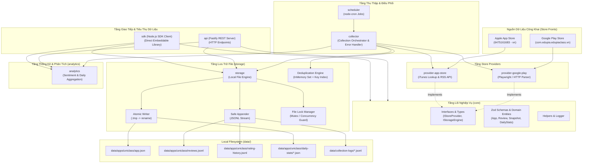
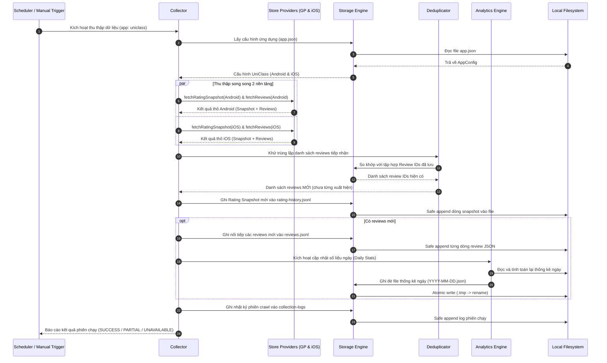

# Tài Liệu Kiến Trúc Hệ Thống (Architecture Documentation)
## Dự án: UniClass Rating Reader

---

### 1. Kiến Trúc Tổng Thể: Modular Monolith

Dự án áp dụng mô hình kiến trúc **Modular Monolith** (Đơn khối theo mô-đun). Mô hình này chia tách rõ ràng trách nhiệm giữa các miền nghiệp vụ thành các mô-đun độc lập, có ranh giới rõ ràng nhưng vẫn đóng gói trong cùng một repository giúp đơn giản hóa quá trình vận hành, kiểm thử và bảo trì mà không cần chi phí quản lý microservices.



---

### 2. Các Mô-Đun Chính & Phân Định Trách Nhiệm (Module Boundaries)

| Tên Mô-đun | Trách nhiệm chính | Quy tắc phụ thuộc |
| :--- | :--- | :--- |
| **`core`** | Định nghĩa toàn bộ interfaces (`IStoreProvider`, `IStorageEngine`), domain types, Zod schemas, validation, lỗi hệ thống và utilities dùng chung. | **Không phụ thuộc vào bất kỳ mô-đun nào khác.** Đóng vai trò là hạt nhân trung tâm. |
| **`provider-google-play`** | Trích xuất rating và reviews từ Google Play Store cho ứng dụng UniClass (`com.edupia.edupiaclass.vn`). | Phụ thuộc vào `core` (triển khai `IStoreProvider`). Không phụ thuộc vào `storage` hay `api`. |
| **`provider-app-store`** | Truy vấn iTunes Lookup API và RSS Feed của Apple App Store cho UniClass (`6475161683`). | Phụ thuộc vào `core` (triển khai `IStoreProvider`). Không phụ thuộc vào `storage` hay `api`. |
| **`storage`** | Tương tác trực tiếp với filesystem cục bộ. Quản lý việc đọc, ghi nguyên tử (atomic), append an toàn, khóa đồng thời (file lock), deduplication và backup. | Phụ thuộc vào `core`. Tuyệt đối không chứa logic scraper hay HTTP. |
| **`collector`** | Điều phối quá trình cào dữ liệu: gọi các providers, xử lý lỗi từng nguồn, khử trùng lặp qua storage, kích hoạt phân tích dữ liệu và ghi log. | Phụ thuộc vào `core`, các `provider-*`, `storage`, `analytics`. |
| **`analytics`** | Tổng hợp số liệu thống kê: đếm review mới, phân loại cảm xúc (positive/neutral/negative), tính điểm trung bình và sinh báo cáo theo ngày. | Phụ thuộc vào `core` và đọc dữ liệu từ `storage`. |
| **`api`** | Cung cấp RESTful API qua Fastify để người dùng hoặc dashboard bên ngoài có thể truy vấn số liệu và kích hoạt cào thủ công. | Phụ thuộc vào `core`, `storage`, `analytics`, `collector`. |
| **`sdk`** | Gói thư viện Node.js cho phép ứng dụng bên thứ ba import và truy cập trực tiếp vào tầng dữ liệu cục bộ hoặc REST API. | Phụ thuộc vào `core` và `storage`. |

---

### 3. Nguyên Tắc Phụ Thuộc (Dependency Inversion Principle)

Để đảm bảo khả năng bảo trì và kiểm thử độc lập:
1. `core` không import bất cứ file nào từ các thư mục provider hay storage.
2. Các provider (`provider-google-play` và `provider-app-store`) buộc phải hiện thực hóa cùng interface `IStoreProvider`:
   ```typescript
   export interface IStoreProvider {
     readonly platform: "android" | "ios";
     fetchRatingSnapshot(config: AppConfig): Promise<ProviderResult<RatingSnapshot>>;
     fetchReviews(config: AppConfig, options?: FetchReviewOptions): Promise<ProviderResult<Review[]>>;
   }
   ```
3. Khi bổ sung một provider mới hoặc thay đổi cách thức cào dữ liệu của một store, các tầng `collector`, `storage`, `analytics` và `api` hoàn toàn không bị thay đổi.

---

### 4. Quy Trình Luân Chuyển Dữ Liệu (Data Flow)



---

### 5. Cơ Chế Xử Lý An Toàn Tầng Filesystem (Zero-Database Architecture)

Do hệ thống không sử dụng cơ sở dữ liệu quan hệ hay NoSQL, mọi thao tác đều đảm bảo các tiêu chuẩn sau:

1. **Khóa chống ghi đồng thời (Concurrency Lock):**
   Mỗi khi có tác vụ ghi dữ liệu vào thư mục của ứng dụng (`data/apps/uniclass`), `LockManager` tạo file khóa `.storage.lock`. Các tác vụ ghi khác sẽ đợi (wait with backoff) hoặc bỏ qua nếu phiên trước đang chạy.

2. **Ghi nguyên tử (Atomic Write) cho các tệp cấu hình & thống kê:**
   Dữ liệu được ghi ra tệp tạm thời trên cùng ổ đĩa trước khi dùng lệnh đổi tên `fs.rename`. Điều này loại bỏ hoàn toàn hiện tượng tệp bị rỗng (0 byte) hoặc hỏng định dạng khi máy tính bị mất điện hoặc crash giữa chừng.

3. **Ghi nối an toàn (Safe Append) cho tệp JSONL:**
   Luôn kiểm tra ký tự ngắt dòng cuối cùng để đảm bảo mỗi bản ghi nằm trên một dòng riêng biệt hợp lệ. Khi một dòng bị lỗi, tầng đọc sẽ bỏ qua (fault-tolerant parser) mà không làm gián đoạn việc đọc các bản ghi còn lại.

4. **Sao lưu trước khi thay đổi (Safe Backup):**
   Hệ thống có cơ chế sao lưu tự động các tệp `.jsonl` định kỳ trước khi thực hiện các tác vụ dọn dẹp hoặc tối ưu hóa.

---

### 6. Cấu Trúc Mã Nguồn Đề Xuất (Source Directory Layout)

```
uniclass-rating-reader/
├── AGENTS.md                          # Quy chuẩn kỹ thuật & quy tắc làm việc cho AI
├── package.json
├── package-lock.json
├── tsconfig.json
├── eslint.config.mjs
├── vitest.config.ts
├── .gitignore
├── docs/                              # Tài liệu kỹ thuật dự án
│   ├── PROJECT_SPECIFICATION.md
│   ├── TECHNICAL_SPECIFICATION.md
│   └── ARCHITECTURE.md
├── data/                              # Local storage (bị gitignore)
│   ├── apps/
│   │   └── uniclass/
│   │       ├── app.json
│   │       ├── reviews.jsonl
│   │       ├── rating-history.jsonl
│   │       └── daily-stats/
│   ├── collection-logs/
│   └── metadata/
│       └── apps-registry.json
└── src/                               # Mã nguồn chính (Modular Monolith)
    ├── core/                          # Domain models, schemas, interfaces
    ├── providers/
    │   ├── google-play/               # Google Play Crawler
    │   └── app-store/                 # Apple App Store Client
    ├── storage/                       # Local filesystem engine, lock, atomic write
    ├── collector/                     # Scheduler & crawler orchestrator
    ├── analytics/                     # Sentiment & daily metrics aggregation
    ├── api/                           # Fastify REST API routes & server
    ├── sdk/                           # Embeddable Node.js SDK
    └── index.ts                       # Entry point khởi động hệ thống
```

